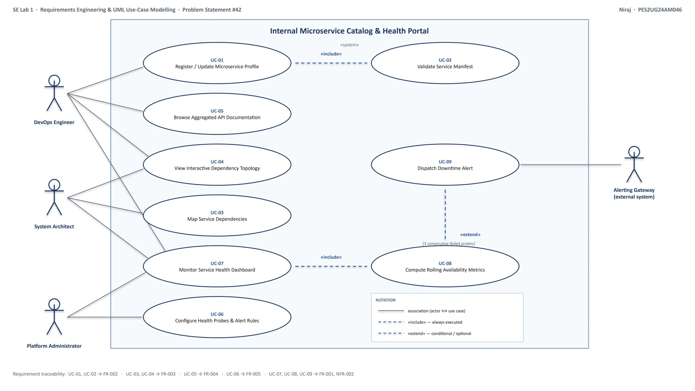

# Lab 1 — Requirements Engineering &amp; UML Use-Case Modelling

**PES University · Department of Computer Science &amp; Engineering · Software Engineering Lab**

| | |
| :--- | :--- |
| **Student** | Niraj |
| **SRN** | PES2UG24AM046 |
| **Problem Statement** | **#42 — Internal Microservice Catalog &amp; Health Portal** (Developer Tools &amp; IT Operations) |
| **Date** | 17 November 2026 |

An enterprise developer portal that maps microservice dependencies, aggregates API documentation into one
searchable index, and runs automated periodic health probes with availability tracking and downtime alerts.

---

## 1. Deliverables (as required by the Lab 1 brief)

| # | Deliverable | Files | Contents |
| :-: | :--- | :--- | :--- |
| **1** | Requirements Table | [`Requirements_Table_Niraj_PES2UG24AM046.docx`](Requirements_Table_Niraj_PES2UG24AM046.docx) · [`.pdf`](Requirements_Table_Niraj_PES2UG24AM046.pdf) | **Exactly 5 FRs** (`FR-001`–`FR-005`) and **2 NFRs** (`NFR-001`, `NFR-002`), each with Req ID, Type, Description, Priority, measurable pass/fail Acceptance Criteria, Rationale and peer-review Comments |
| **2** | UML Use-Case Diagram | [`UML_Use_Case_Diagram_Niraj_PES2UG24AM046.pdf`](UML_Use_Case_Diagram_Niraj_PES2UG24AM046.pdf) · [`.png` preview](UML_Use_Case_Diagram_Preview_Niraj_PES2UG24AM046.png) · [editable source](Use_Case_Diagram_Source_Niraj_PES2UG24AM046.pptx) | 4 actors, system boundary, **9 use cases** (`UC-01`–`UC-09`), associations, **two `«include»`** and **one `«extend»`** relationships, notation legend and requirement traceability |
| **3** | Use-Case Flow Specification | [`Use_Case_Flow_UC07_Niraj_PES2UG24AM046.docx`](Use_Case_Flow_UC07_Niraj_PES2UG24AM046.docx) · [`.pdf`](Use_Case_Flow_UC07_Niraj_PES2UG24AM046.pdf) | One-page flow for **UC-07 Monitor Service Health Dashboard**: preconditions, success/failure postconditions, 10-step main success scenario, alternate flows `4a` (alert threshold reached) and `6a` (empty filtered view) |

---

## 2. Actors

| Actor | Type | Purpose in the system |
| :--- | :--- | :--- |
| **DevOps Engineer** | Primary (human) | Onboards and maintains service records, browses aggregated API documentation, watches the health dashboard |
| **System Architect** | Primary (human) | Maps dependencies between services and investigates the interactive topology graph for blast-radius analysis |
| **Platform Administrator** | Primary (human) | Owns health-check and alert-rule configuration, roles and the audit trail |
| **Alerting Gateway** | Secondary (external system) | Receives downtime and recovery notifications (e-mail / Slack / PagerDuty) dispatched by the portal |

## 3. Use cases

| ID | Use case | Primary actor(s) | Requirement |
| :--- | :--- | :--- | :--- |
| `UC-01` | Register / Update Microservice Profile | DevOps Engineer | FR-002 |
| `UC-02` | Validate Service Manifest | *(included by UC-01)* | FR-002 |
| `UC-03` | Map Service Dependencies | System Architect | FR-003 |
| `UC-04` | View Interactive Dependency Topology | System Architect, DevOps Engineer | FR-003, NFR-001 |
| `UC-05` | Browse Aggregated API Documentation | DevOps Engineer | FR-004 |
| `UC-06` | Configure Health Probes &amp; Alert Rules | Platform Administrator | FR-005 |
| `UC-07` | Monitor Service Health Dashboard | Platform Administrator, DevOps Engineer, System Architect | FR-001 |
| `UC-08` | Compute Rolling Availability Metrics | *(included by UC-07)* | FR-001, NFR-002 |
| `UC-09` | Dispatch Downtime Alert | Alerting Gateway | FR-001 |

## 4. Relationships modelled in the diagram

| Relationship | From → To | Why |
| :--- | :--- | :--- |
| `«include»` | `UC-01` → `UC-02` | A service profile is *always* validated before it is stored — reuse of one validation behaviour |
| `«include»` | `UC-07` → `UC-08` | Opening the dashboard *always* requires availability to be computed from probe history |
| `«extend»` | `UC-09` → `UC-08` | Alert dispatch is *conditional*: it happens only when `[3 consecutive failed probes]` are observed; the base use case completes without it |

## 5. Compliance check against the lab brief

| Requirement of the brief | Delivered |
| :--- | :--- |
| Exactly 5 FRs `FR-001`–`FR-005` | ✅ `FR-001` retained from the problem statement, `FR-002`–`FR-005` elicited |
| 2 NFRs `NFR-001`, `NFR-002` | ✅ `NFR-001` retained, `NFR-002` added |
| ID, Type, Description ("shall …"), Priority, Acceptance Criteria, Rationale | ✅ plus a peer-review **Comments** column from the lab template |
| Measurable pass/fail acceptance criteria on every row | ✅ every row states an explicit **Pass** and **Fail** condition with a number to verify |
| UML diagram with all actors, primary use cases, ≥ 1 `«include»` and ≥ 1 `«extend»` | ✅ 4 actors, 9 use cases, 2 includes, 1 conditional extend |
| ≥ 3 actors and ≥ 5 use cases | ✅ 4 actors, 9 use cases |
| Use-case flow: 1 page, preconditions, postconditions, main success scenario, ≥ 1 alternate flow | ✅ 1 page, 2 alternate flows, exported to PDF |

## 6. Notes

* `FR-001` and `NFR-001` are the requirements supplied in the problem statement; their wording is preserved and
  only the acceptance criteria and rationale were made measurable, as the template requires.
* The diagram source (`*.pptx`) is included so the model can be edited without redrawing it; the PDF is the
  submitted artefact.
* The use-case flow was verified to render on exactly one A4 page in the exported PDF.
